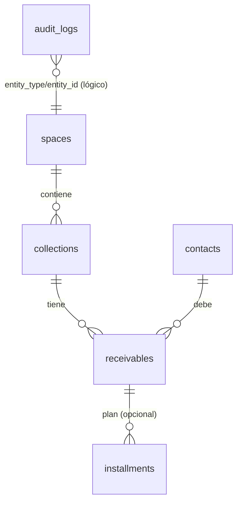

# Modelo de datos (esquema Drift v1)

| Tabla | Notas |
|---|---|
| `spaces` | Ámbitos (familia, negocio…). `archived_at` en vez de borrar. |
| `contacts` | Agenda global; una ficha por persona, reutilizable entre espacios y cobros. |
| `collections` | Cobro/campaña. `kind` y `funds_ownership` con CHECK. |
| `receivables` | Deuda individual. `principal_minor > 0`; UNIQUE(collection_id, contact_id). |
| `installments` | Cuotas opcionales. UNIQUE(receivable_id, sequence). |
| `audit_logs` | Auditoría de cambios críticos (valores viejo/nuevo en JSON). |
| `app_settings` | Preferencias no secretas. |

Convenciones: PK `id` UUID v4 (texto), `created_at`/`updated_at`, dinero en enteros (céntimos) + `currency`,
`PRAGMA foreign_keys=ON`. Cada escritura va en transacción junto con su registro de auditoría.

Pendiente (Fases 2-3): `payments`, `payment_allocations`, `attachments`, `settlements`.
